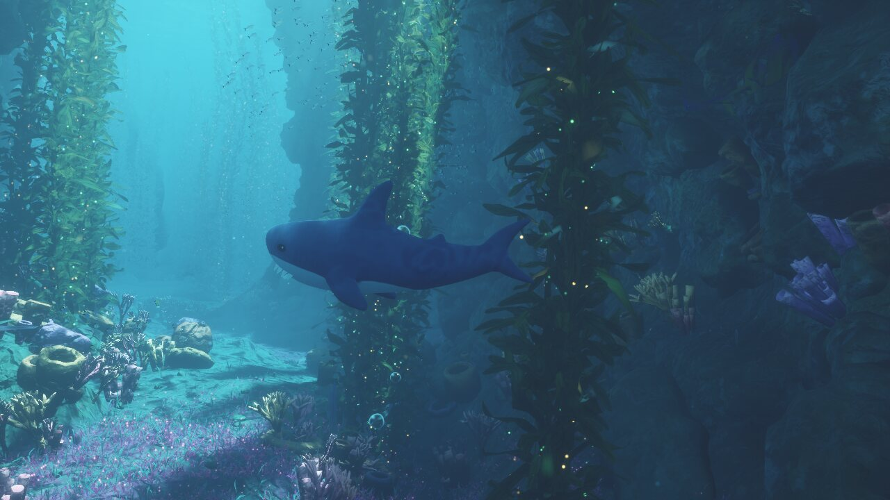
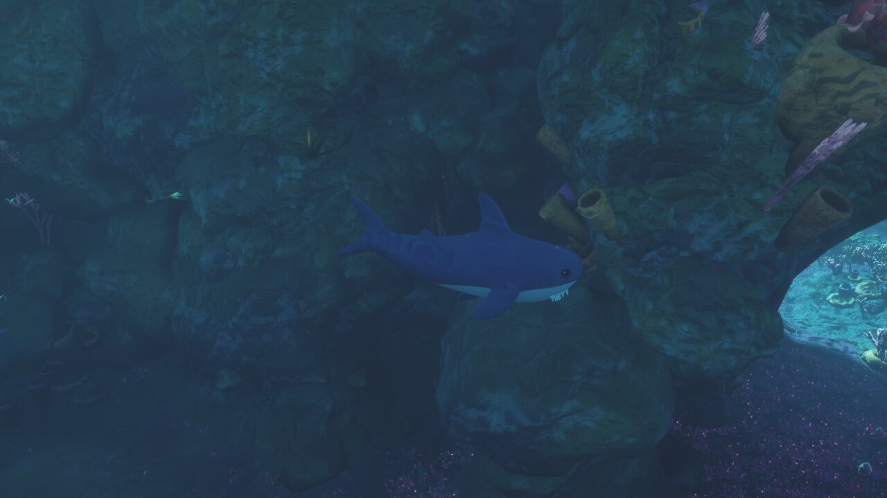
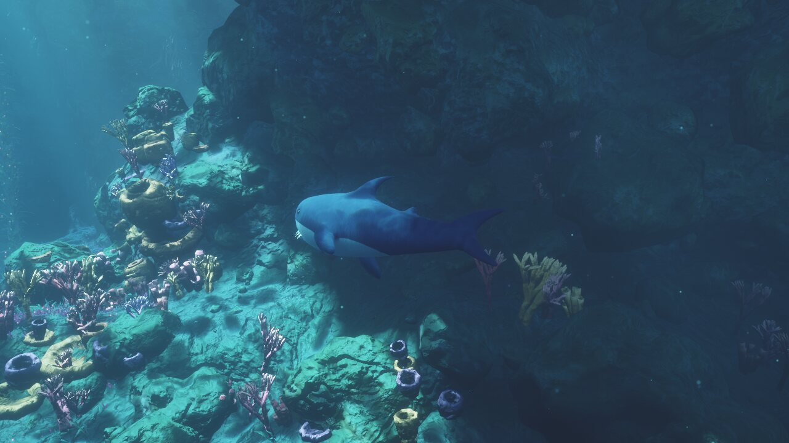
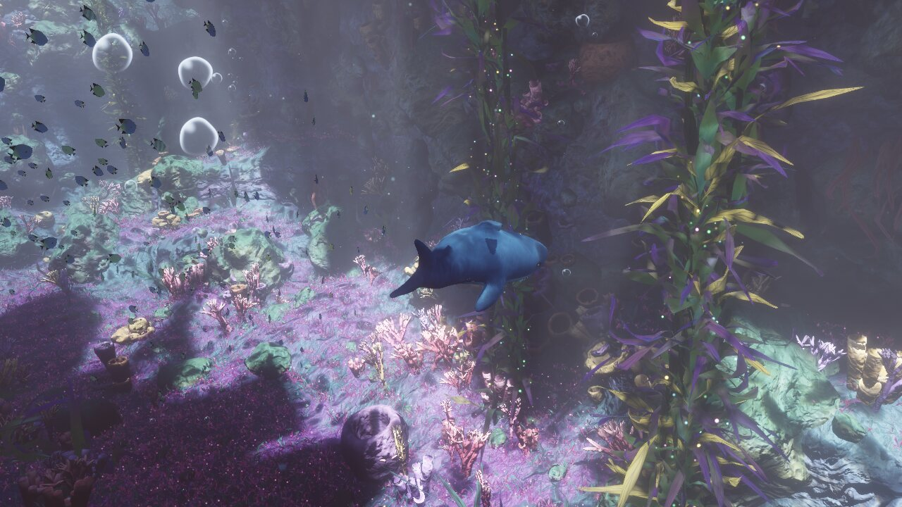

# Hajsaver

**Blåhaj swims through the Abyssal Garden.** A screensaver: a native Windows `.scr`, and the same thing as a
web page for GitHub Pages.



The shark is the Blåhaj model from [Coral-coder/Blahaj](https://github.com/Coral-coder/Blahaj). The world is
[Abyssal Garden](https://github.com/Coral-coder/abyssal-garden): kelp forests, light shafts, caustics, a sunken
ship, a stone whale tail, sponge gardens and a purple grotto, all generated by code.

| | |
|---|---|
|  |  |



## What it does

- **Blåhaj swims.** A wave runs down his body and his tail beats faster when he speeds up. His pectoral fins flap and
  steer, and his dorsal fin and tail lobe lag behind his turns. He banks into curves and sometimes puts on a burst of
  speed.
- **He never goes through rock.** Swimming uses the world's collision field: the seabed, cliffs and arches, plus the
  ship and the whale tail. He feels ahead and turns away from the rock, weaves between kelp stems, and circles the
  sights he passes. If he does get boxed in, he turns around and rises out of it.
- **The camera works like a film crew.** Eight kinds of shot follow him: chase, side tracking, a telephoto ambush
  waiting ahead of him, low angles looking up toward the surface, orbits, head-on, wide establishing shots, and a
  close follow. Each shot lasts 6 to 12 seconds and dips to black before the next. Every camera stays in open water.
  A shot that loses sight of him, behind rock or kelp, cuts early.
- **More fish.** Besides the original silver schools there are blue and yellow reef fish, yellow tangs and striped
  jacks. Schools part around the shark as he swims through.
- **A live shadow.** He casts a shadow on the seabed and on the plants, and it also blocks the light shafts.
- **No floating rocks.** The original's floating boulder clusters were removed. Every rock sits on the seabed.

## Windows screensaver

The `.scr` is a native Win32 program. It draws with wgpu, using Vulkan or Direct3D 12. There is no browser, web
view or JavaScript in it.

1. Download `Hajsaver.scr` from the [latest release](https://github.com/Coral-coder/Haj-saver/releases/latest)
   (or from the web page's "Windows screensaver" button).
2. Right-click it and choose **Install**. You can also copy it to `C:\Windows\System32` and pick **Hajsaver** in
   *Screen Saver Settings*.
3. **Settings** (`/c`) chooses the detail level: High, Medium or Low. On top of that, the resolution adjusts itself
   to keep the picture smooth.

It covers every monitor. Moving the mouse or pressing a key ends it. The small preview in Screen Saver Settings
(`/p`) works too.

## Web version

`web/index.html` loads the same renderer compiled to WebAssembly. It needs a browser with WebGPU, such as a
current Chrome or Edge. Double-click or press `F` for full screen. Add `?q=0`, `?q=1` or `?q=2` to the URL to set
the detail level (High, Medium or Low).

The page is at https://coral-coder.github.io/Haj-saver/.

The workflow in `.github/workflows/build.yml` builds both. On the default branch it publishes the page to the
`gh-pages` branch and updates the `latest` release with `Hajsaver.scr`. A tag like `v1.0.0` makes a versioned
release. If the page doesn't appear, check **Settings → Pages**: *Deploy from a branch*, `gh-pages`, `/ (root)`.

## Building

You need Rust 1.88 or newer.

```bash
cargo build --release                                        # native, for your own platform
cargo build --release --target x86_64-pc-windows-gnu         # Hajsaver.scr from Linux (needs gcc-mingw-w64-x86-64)
./tools/build-web.sh                                         # web/pkg + web/Hajsaver.scr (needs wasm-bindgen-cli)
```

On Windows, `cargo build --release` builds `target\release\hajsaver.exe`. Rename it to `Hajsaver.scr`.

On other systems the native program renders off screen to PNG files. This is how the look and the camera work are
checked without a Windows machine:

```bash
target/release/hajsaver --out shots --size 1280x720 --level 0 --start 20 --frames 8 --every 9
target/release/hajsaver --level 2 --sim 3600        # an hour of swimming, no drawing: collision and shot statistics
```

| File | What's inside |
|---|---|
| `src/shark.rs` | Loading the Blåhaj model, and his swimming: route, steering, obstacle avoidance, fin springs |
| `src/director.rs` | The camera shots and the cuts between them |
| `src/render.rs` | The renderer (Abyssal Garden's `main.js`, ported to wgpu), plus the shark, his shadow and dynamic resolution |
| `src/world.rs` | The world generator (Abyssal Garden's `world.js`) and the collision field |
| `src/math.rs` | Noise, random numbers, surface nets, mesh helpers |
| `shaders/*.wgsl` | Abyssal Garden's shaders, extracted by `tools/extract-shaders.mjs`, and `shark.wgsl` |
| `src/win.rs` | The Windows screensaver: window, `/s` `/p` `/c`, settings in the registry |
| `src/web.rs`, `web/index.html` | The web page |

## Credits

- Blåhaj model: ["Blahaj"](https://sketchfab.com/3d-models/blahaj-ce981de49111488c81ea646067abe1ec) by
  [Kaine_G](https://sketchfab.com/Kaine_G), [CC BY 4.0](https://creativecommons.org/licenses/by/4.0/), via
  Coral-coder/Blahaj. Changes: the fins are subdivided and the model is animated in a vertex shader.
- World, shaders and generator: [Abyssal Garden](https://github.com/Coral-coder/abyssal-garden) by Maksymilian
  Dendura, MIT.
- Everything else: MIT, see [LICENSE](LICENSE).
